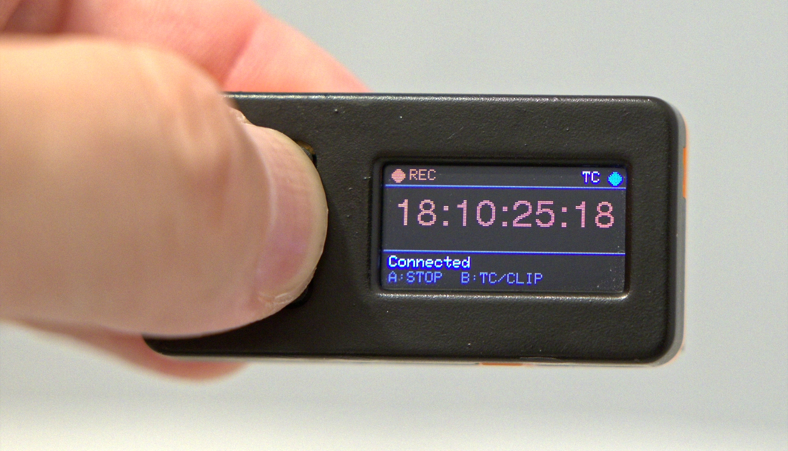

# ⏱️ MagicPilot Remote Stick

### 🎬 Timecode and record button for your Blackmagic camera, on a tiny M5Stick.


A pocket-sized Bluetooth LE remote for the original M5StickC (80×160 screen, ESP32) and M5Stack StickS3 (135×240 screen, ESP32-S3). It shows the camera's **live timecode** and starts or stops **recording** with one press. Small sibling of [MagicPilot Remote](https://github.com/KenFilms/MagicPilot_Remote), whose Bluetooth code it is based on.



## Supported hardware

| Device | Chip | Display (landscape) | PlatformIO environment | Verification |
| --- | --- | --- | --- | --- |
| Original M5StickC | ESP32 | 160×80 | `m5stick-c` | Firmware build passes |
| M5Stack StickS3 | ESP32-S3 | 240×135 | `m5stick-s3` | Firmware build, automatic chip detection, upload, and flash hash verification pass |

StickS3 flashing was verified on physical hardware on **2026-10-15**. Camera pairing, timecode display, and recording control on StickS3 still need hardware verification. Other Stick variants are not currently supported targets.

## 🕹 Buttons

| Screen | Button | Action |
| --- | --- | --- |
| Main | **A** (front) | Connect; once connected, start/stop recording |
| Main | **B** (side) | Switch between timecode and clip counter |
| PIN | **B** | Next digit value (0-9); hold for back one digit |
| PIN | **A** | Accept digit; after the 6th digit, submit the PIN |

## 🔗 Pairing

Put the camera in Bluetooth pairing mode, press **A** on the stick, then enter the 6-digit PIN shown on the camera.

## 🚀 Build and flash

### Automatic selection (recommended)

Install Python 3 and PlatformIO Core or the PlatformIO VS Code extension, connect one supported Stick with a USB data cable, close serial monitors, and run from the project folder:

```sh
python3 flash.py
```

On Windows, use `py flash.py`. The helper finds PlatformIO (including the VS Code extension's default installation), reads the chip type with esptool, then builds and uploads only the matching environment. The display layout adapts to the screen size. The first run downloads the required tools and libraries.

The probe resets the Stick into download mode. On StickS3, the factory firmware may require manual entry first:

1. Connect the StickS3 with a USB data cable.
2. Hold the side reset button until the internal green LED flashes.
3. Run `python3 flash.py` again.

This procedure was required for the verified StickS3 upload. After a successful upload, flash hashes are checked and the device resets automatically. Press **A** to start connecting to the camera.

If the helper reports **No USB serial device found**, check the cable and repeat the download-mode steps. Use `pio device list` to find the current port. The helper retries a USB port change when it can identify the same USB location; otherwise, rerun it with the new port. See [M5Stack's download-mode instructions](https://docs.m5stack.com/en/core/StickS3).

If multiple USB serial devices are connected, specify the Stick's port rather than guessing:

```sh
python3 flash.py --port /dev/cu.usbmodem3101
python3 flash.py --detect-only
```

Use your actual port (`COM3`, for example, on Windows). `--detect-only` reads the chip without writing flash; reset or power-cycle afterwards to resume the existing firmware. Unsupported chips and failed probes stop the upload. Detection distinguishes **ESP32 from ESP32-S3**, not M5Stack products from other boards using those chips; use it only with the two supported Stick models.

### Explicit PlatformIO targets

```sh
pio run -e m5stick-c -t upload
pio run -e m5stick-s3 -t upload
```

Plain `pio run` / `pio run -t upload` still defaults to the original StickC; use the helper for automatic selection. ESP32 and ESP32-S3 require separate binaries, so detection must happen before building/uploading, not inside the firmware.

To build both targets without flashing: `pio run -e m5stick-c -e m5stick-s3`. To test the uploader logic, run `python -m unittest discover -s tests -v` in PlatformIO's Python environment.

### Arduino IDE (manual board selection)

1. Install the **esp32 by Espressif Systems** board package (**2.0.17**) and the **M5StickC** library.
2. Open `MagicPilot_Remote_Stick.ino` with the `src` folder next to it.
3. Select the board **M5Stick-C** and the partition scheme **Huge APP (3MB No OTA/1MB SPIFFS)**, then upload.

For **StickS3**, use the same ESP32 board package version with **ESP32S3 Dev Module**, **8MB flash**, **OPI PSRAM**, **USB CDC On Boot enabled**, **Hardware CDC and JTAG** USB mode, and an 8MB partition scheme with at least 3MB for the app. Install **M5Unified 0.2.26 or newer**, **M5GFX 0.2.33 or newer**, and **M5PM1 1.0.7 or newer** instead of M5StickC. The source automatically uses M5Unified when compiling for ESP32-S3. PlatformIO uses pinned driver revisions; Arduino IDE does not run the automatic upload helper.

## Source layout

| File | Responsibility |
| --- | --- |
| [src/main.cpp](src/main.cpp) | Arduino `setup()` and `loop()` orchestration |
| [src/Board.h](src/Board.h) | StickC/StickS3 library selection, power, display initialization, and screen dimensions |
| [src/RemoteState.h](src/RemoteState.h) | Shared camera, pairing, timecode, and redraw state |
| [src/CameraProtocol.h](src/CameraProtocol.h) | Camera command templates, packet decoding, and timecode validation/filtering |
| [src/CameraBluetooth.h](src/CameraBluetooth.h) | BLE scanning, pairing, service discovery, notifications, and command writes |
| [src/RemoteUI.h](src/RemoteUI.h) | Main/PIN screens, button handling, and incremental redraws |

The firmware headers are internal, header-only modules in the `MagicPilot` namespace. They declare their own dependencies and are compiled through `src/main.cpp` as a single translation unit for both PlatformIO and Arduino IDE. Their static state is not intended to be shared across additional `.cpp` files.

The camera protocol can also be tested without a Stick or Arduino libraries. On macOS/Linux with a C++ compiler:

```sh
c++ -std=c++11 -Isrc tests/test_camera_protocol.cpp -o /tmp/magicpilot-protocol-test
/tmp/magicpilot-protocol-test
```

## ⚠️ Disclaimer

Use at your own risk. MagicPilot is provided "as is" without warranty. The developer is not
responsible or liable for damage, malfunction, loss of footage, data loss, or any
other loss or damage to cameras, lenses, recording media, accessories, equipment, or
property resulting from the use of this software or firmware. Always verify
settings, compatibility, and operation before using MagicPilot with valuable or
professional equipment.

MagicPilot is an independent open-source project and is not affiliated with,
endorsed by, or sponsored by Blackmagic Design Pty. Ltd. Blackmagic Design,
Blackmagic Pocket Cinema Camera, BMPCC, and related names and trademarks are the
property of Blackmagic Design Pty. Ltd. MagicPilot is developed independently for use
with compatible Blackmagic cameras.
